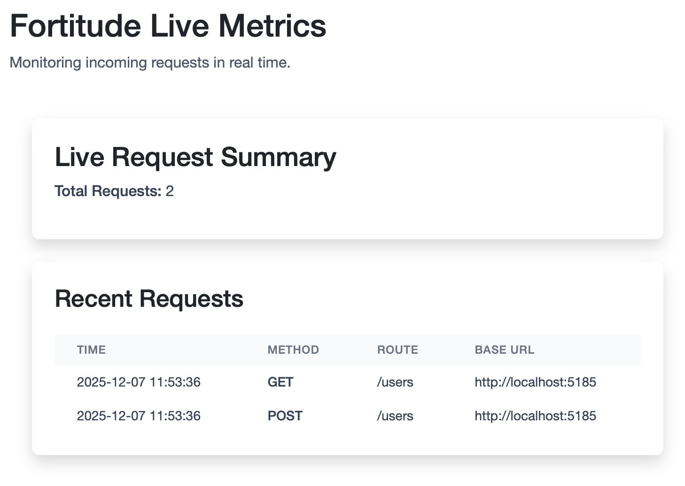

# Fortitude Server
_Fortitude spins up a local mock server so you can fluently configure HTTP routes, responses, and test scenarios directly from your .NET tests._

<p align="center">
  
</p>

<p align="center">
  <a href="https://github.com/Timmoth/Fortitude/actions/workflows/ci.yml"></a>
  <a href="https://www.nuget.org/packages/Fortitude"></a>
  <a href="https://www.nuget.org/packages/Fortitude"></a>
  <a href="https://hub.docker.com/r/aptacode/fortitude-server"></a>
  <a href="./LICENSE"></a>
</p>

[NuGet](https://www.nuget.org/packages/Fortitude) - 
[Docker](https://hub.docker.com/r/aptacode/fortitude-server)

## What is Fortitude?
Fortitude is a .NET testing utility that lets you control and simulate external HTTP APIs directly from your tests. It’s perfect for functional and behavioral testing when your system under test (SUT) depends on services that are unavailable, difficult to run locally, or expensive to maintain.

With Fortitude, your tests can:
- **Define expected API behavior dynamically and fluently**, including headers, query parameters, methods, and body content
- **Perform true black-box integration** tests without fragile mocks or stubs
- **Track, assert, and wait for requests** to ensure the SUT interacts with external services correctly
- **Simulate realistic responses** so your SUT thinks it’s calling real APIs
- **Run multiple tests concurrently** against the same mocked service without conflicts, thanks to per-client port reservation


Fortitude keeps expected behavior close to the test code, increases code coverage, and reduces the complexity of maintaining mocks. Essentially, it gives you full control over your SUT’s external dependencies while letting your tests remain fast, reliable, and expressive.

## Docs

*   [mocking-apis](./docs/mocking.md)
*   [configuration](./docs/configuration.md)
*   [architecture](./docs/architecture.md)
*   [local-development](./docs/local-development.md)
*   [aspire-integration-tests](./docs/aspire-integration-tests.md)
*   [handler-builder-usage](./docs/handler-builder-usage.md)
*   [response-builder-usage](./docs/response-builder-usage.md)
*   [yaml-handlers](./docs/yaml-handlers.md)
*   [admin-api](./docs/admin-api.md)
*   [openapi](./docs/openapi.md)
*   [record-and-replay](./docs/record-and-replay.md)

### Running the Fortitude Server via Docker

```bash
# Pull the latest Fortitude Server image:
docker pull aptacode/fortitude-server:latest

# Run on a single specific port
docker run -e PORT=5005 -p 5005:5005 aptacode/fortitude-server:latest

# Run with a port range (recommended for parallel test execution)
docker run -e PORTS=5000-5005 -p 5000-5005:5000-5005 aptacode/fortitude-server:latest

# [optional] pass through YAML defined handlers
docker run -e PORT=5005 -p 5005:5005 -v ./config:/app/config aptacode/fortitude-server:latest
```

### Configuration

| Setting | Default | Description |
|---|---|---|
| `PORT` | – | Bind a single port. |
| `PORTS` | – | Bind several ports, as a list and/or range (`5000-5005`, `8080,8082`). Each connecting client reserves one, which is what keeps parallel tests isolated. |
| `Settings:ResponseTimeoutSeconds` | `5` | How long the server waits for a client to produce a response before returning `504`. Raise it for slow handlers, or to step through a responder in a debugger. |
| `Settings:Broadcast` | `false` | Force every client to receive every request, ignoring port routing. Disables isolation — only use it with a single connected client. |
| `Settings:MaxMessageSizeBytes` | `33554432` (32 MB) | Largest request or response body that can be relayed to a connected client. Bodies travel over SignalR, which caps messages at 32 KB unless raised — too small for an ordinary JSON fixture. |
| `Settings:ConfigDirectory` | `config` beside the executable | Where YAML handler definitions are read from. Searched recursively for `.yaml` and `.yml`. Relative paths resolve against the application directory. |
| `Settings:HotReload` | `true` | Watch the handler directory and reload definitions when they change, without a restart. |
| `Settings:EnableAdminApi` | `true` | Serve the admin REST API at `/fortitude/api`, which lets any language list, write and delete handler definitions and read observed traffic. Unauthenticated, like the UI. |
| `Settings:EnableAdminUi` | `true` | Serve the live monitoring and YAML editing UI at `/fortitude`. The UI is unauthenticated and can write handler files — turn it off when the server is reachable by anything you do not trust. |

`Settings:*` keys are ordinary .NET configuration, so they can be set via environment variable
(`-e Settings__ResponseTimeoutSeconds=30` in Docker) or `appsettings.json`.

### Example

[An example project / tests can be in the examples directory.
](Examples/)

To run the example tests:
```bash
# Run the Fortitude Server Project
dotnet run --project ./Fortitude.Server/

# Or run on a single fixed port
docker run -e PORT=5005 -p 5005:5005 aptacode/fortitude-server:latest

# Run the tests
dotnet test ./Examples/Fortitude.Example.Tests

```

**Make sure to add the NuGet package to your test project**

[Fortitude on NuGet](https://www.nuget.org/packages/Fortitude)

```bash
# Install via the .NET CLI:
dotnet add package Fortitude
```

## Quick start

```bash
dotnet add package Fortitude
```

No server, no configuration - intercept the calls your code makes and assert on them:

```csharp
[Fact]
public async Task TheClientSendsTheRightRequest()
{
    var fortitude = FortitudeClient.Create(output);

    var handler = fortitude.Accepts()
        .Get()
        .HttpRoute("/users/{id}")
        .Returns((req, res) => res.Ok(new User(1, "Alice")));

    var services = new ServiceCollection();
    services.AddFortitudeClient(fortitude);          // every HttpClient is now intercepted
    services.AddHttpClient<UserClient>();

    var users = services.BuildServiceProvider().GetRequiredService<UserClient>();

    var user = await users.GetAsync(1);

    Assert.Equal("Alice", user.Name);
    handler.ShouldHaveReceivedOnce();
    fortitude.VerifyNoUnmatchedRequests();           // nothing called that you did not set up
}
```

That is the whole loop. The rest of this page covers running Fortitude as a real server, so
your service makes genuine HTTP calls and you can test it as a black box.

## Using Fortitude in Tests

There are **three ways** to write tests with Fortitude:

### 1. External Mock Server Mode

- You start the Fortitude Server (via Docker or locally)  
- Your SUT is configured to point to the Fortitude Server URL  
- Requests leave your service and hit the server, where handlers produce responses  

```csharp
    [Fact]
    public async Task CreateUser_ForwardsRequestToExternalApi_AndReturnsCreatedResult()
    {
        // Given: Fortitude fake server simulating the external API
        var (fortitude, mockServiceUrl) = await FortitudeServer.ConnectAsync(FortitudeBase, output);

        var expectedName = "Alice";
        var expectedEmail = "alice@example.com";

        // Fake external handler: POST /users
        var handler = fortitude.Accepts()
            .Post()
            .HttpRoute("/users")
            .Body(body => body.ToJson<User>()?.Email == expectedEmail)
            .Returns((request, response) =>
            {
                var reqObj = request.Body.ToJson<User>()!;
                response.Created(new User(999, reqObj.Name, reqObj.Email));
            });
        
        // And: The SUT (your API) is running with ExternalApi.BaseUrl overridden
        var client = factory
            .WithWebHostBuilder(builder =>
            {
                builder.ConfigureAppConfiguration((ctx, config) =>
                {
                    config.AddInMemoryCollection(new Dictionary<string, string?>
                    {
                        // Configure your SUT to point at the Fortitude Server
                        ["ExternalApi:BaseUrl"] = mockServiceUrl
                    });
                });
            })
            .CreateClient();

        // WHEN: Client calls into your SUT API
        var response = await client.PostAsJsonAsync("/users", new User(0, expectedName, expectedEmail));

        response.EnsureSuccessStatusCode();

        var created = await response.Content.ReadFromJsonAsync<User>();
        
        // Then: Response should be what Fortitude returned
        Assert.NotNull(created);
        Assert.Equal(999, created!.Id); // ID assigned by external service
        Assert.Equal(expectedName, created.Name);
        Assert.Equal(expectedEmail, created.Email);
        
        // Assert only a single request was made to the handler
        Assert.Single(handler.ReceivedRequests);

        // Cleanup
        await fortitude.StopAsync();
    }
```

### 2. In-Memory / Intercept Mode

- No external server required  
- Outgoing `HttpClient` calls from your SUT are intercepted **before they leave your process**  
- Fast, isolated, perfect for unit or functional tests  
- Handlers are defined in code and can match requests by method, route, headers, query parameters, or body predicates  
- Responses are generated in memory and returned directly to the SUT


```csharp
[Fact]
    public async Task CreateUser_HandlesRequestInternally_AndReturnsCreatedResult()
    {
        // GIVEN
        var expectedName = "Alice";
        var expectedEmail = "alice@example.com";
        // Create Fortitude Client
        var fortitude = FortitudeClient.Create(output);
        
        // Configure Fortitude Handler
        var handler = fortitude.Accepts()
            .Post()
            .HttpRoute("/users")
            .Body(body => body.ToJson<User>()?.Email == expectedEmail)
            .Returns((request, response) =>
            {
                var reqObj = request.Body.ToJson<User>()!;
                response.Created(new User(999, reqObj.Name, reqObj.Email));
            });
        
        // Create SUT
        var client = factory
            .WithWebHostBuilder(builder =>
            {
                builder.ConfigureServices(s =>
                {
                    // Register Fortitude Client
                    s.AddFortitudeClient(fortitude);
                });
            })
            .CreateClient();
        
        // WHEN: Client calls into your SUT API
        var response = await client.PostAsJsonAsync("/users", new User(0, expectedName, expectedEmail));

        response.EnsureSuccessStatusCode();

        var created = await response.Content.ReadFromJsonAsync<User>();
        
        // Then: Response should be what Fortitude returned
        Assert.NotNull(created);
        Assert.Equal(999, created!.Id); // ID assigned by external service
    }
```

### 3. YAML Defined handlers

YAML-defined handlers allow you to run a fully configurable mock API without writing any C# code. You can mount a directory of YAML files into the Fortitude Server and define how requests should be matched and what responses should be returned.
```yaml
handlers:
  - match:
      methods: [POST]
      route: /users/{id}
      body:
        json: email == "alice@example.com"
    response:
      status: 201
      body:
        json:
          id: {{route.id}}
          name: {{body.name}}
          email: {{body.email}}
```
In this example, any POST /users request whose JSON body contains an email of alice@example.com will receive a 201 Created response with a mock user object.

## Which handler answers

Several handlers can match the same request. The one that answers is:

1. The **highest `Priority(n)`**, which defaults to `0`.
2. Among equal priorities, the **most recently registered**.

That default is deliberate: a test can override a handler set up in a fixture or base class
just by registering its own afterwards. A handler that has used up a `Times(n)` allowance, or
whose scenario is in the wrong state, does not match at all and steps aside for the next one.

**YAML handlers are matched first**, on the server, before a request is forwarded to any
connected client. A YAML definition therefore wins over a client-registered handler for the
same route, and the client never sees the request.

If nothing matches, the request gets `501 Not Implemented` and is recorded - call
`VerifyNoUnmatchedRequests()` to turn that into a clear test failure rather than a confusing
response.

## Live Server

When you start the Fortitude Server a Blazor front end that can be used to monitor all traffic will be accesible, for example at: 
`http://localhost:5185/fortitude` 

<p align="center">
  
</p>

## How it works

```
[Test Code] 
    │
    │ 1. Start FortitudeClient + define handlers
    ▼
[Fortitude Client]
    │
    │ 2. Connects to Fortitude Server (SignalR)
    ▼
[Fortitude Server]
    │
    │ 3. Waits for incoming HTTP requests from SUT
    ▼
[SUT Service]
    │
    │ 4. Makes HTTP call to what it thinks is a real API
    ▼
[Fortitude Server Middleware]
    │
    │ 5. Intercepts request (catch-all middleware)
    │ 6. Determines the port the request was sent to
    │ 7. Routes the request to the client assigned to that port
    ▼
[Fortitude Client / Test]
    │
    │ 8. Matches request using:
    │      - Method
    │      - Route
    │      - Headers
    │      - Query params
    │      - Body predicates
    │
    │ 9. Selects last matching handler → produces a FortitudeResponse
    ▼
[Fortitude Server]
    │
    │ 10. Returns the fake response to the SUT
    ▼
[SUT Service]
    │
    │ 11. Processes the response as if from a real dependency
    ▼
[Test Code]
    │
    │ 12. Assert on outputs, triggered flows, and the returned data
    ▼
[End]
```

## FAQ

**What is Fortitude?**  
A mock HTTP server for .NET that lets tests define API behavior dynamically and track requests.

**How is it different from request interceptor libraries?**  
It runs as a separate server, enabling black-box testing without modifying the SUT.

**How does it compare to other Mock Servers?**  
The difference that matters is where the handler logic runs. In Fortitude it runs *in your
test*, so a response can close over test state, assert mid-flight, or compute an answer from
the request. Most mock servers want a static description uploaded to them instead.

| | Fortitude | WireMock.Net | MockServer | Prism |
|---|---|---|---|---|
| Handler logic runs in your test | yes | partly (callbacks, in-process only) | no | no |
| Standalone server for black-box tests | yes | yes | yes | yes |
| In-process interception | yes | yes | no | no |
| Config without writing code | YAML, admin API | JSON | JSON/Java | OpenAPI |
| Generate a mock from OpenAPI | yes | no | yes | yes (its whole purpose) |
| Record from a real service | yes | yes | yes | no |
| Stateful scenarios | yes | yes | yes | no |
| Fault injection | yes | yes | yes | limited |
| Primary language | .NET | .NET | Java | Node |

Prism is the better tool if all you want is "serve this OpenAPI spec". Fortitude is aimed at
the case where the test needs to *control* the dependency, not just stand one up.

**Why use a separate server instead of an intercepting HttpClient?**  
It allows realistic HTTP testing, multi-service flows, and true black box testing.

**Can I verify requests made to the server?**  
Yes, handlers track all intercepted requests for assertions and reporting.

**What are common use cases?**  
Integration tests, simulating errors, e2e flows and local development.

**Can it emulate APIs for local development?**  
Yes, and future plans include a marketplace for shared API emulators.

**Does it work with non-.NET services?**  
Yes. Any HTTP client can call the mock, and the [admin API](./docs/admin-api.md) lets any
language configure handlers and read observed traffic, so the server can be driven from a
JS, Python, Java or Go test suite without a Fortitude client library.

**What are current limitations?**  
The primary client is .NET, though the [admin API](./docs/admin-api.md) lets any language drive
the server. The external server is only needed for black-box testing; intercept mode runs
in-process.

**Why is it called Fortitude?**  
It's named after Operation Fortitude, a WW2 deception campaign, reflecting simulated external behavior.

**Can I run multiple tests or services in parallel?**  
Yes! Fortitude automatically assigns each connected client a unique port from the port range you provide via PORTS.
Each client only receives requests that arrive on the port it was assigned, so test instances stay isolated,
avoiding collisions and enabling true parallel execution.

**What if there aren't enough ports for every client?**  
A client that can't reserve a port still connects, but becomes *unrouted*: it receives any request that arrives on a
port no client owns, and so does every other unrouted client. That is shared, not isolated — the server logs a warning
when it happens. Give the server a wider range via `PORTS` to get a port per concurrent client. Running with no ports
configured at all (for example against an in-memory `TestServer`) means every client is unrouted, which is the expected
behaviour for a single-client setup.

**Can I turn port routing off?**  
Set `Settings:Broadcast=true` to force every client to receive every request regardless of port. This disables
isolation, so only use it when a single client is connected. It is off by default.


## Troubleshooting

**`503 No Fortitude client is connected for port N`**  
Nothing has reserved that port. Either no client is connected, or the client reserved a
different one. `ConnectAsync` returns the URL to use - point your system under test at that
rather than at the base URL.

**`501 Not Implemented`**  
The request arrived but matched no handler. Call `VerifyNoUnmatchedRequests()` to see what
arrived alongside what was registered, including handlers that are exhausted or waiting on a
scenario state.

**`504 Gateway Timeout`**  
The client did not answer within `Settings:ResponseTimeoutSeconds` (5 by default). Expected if
you set a longer `WithDelay`; otherwise raise the setting, or check whether the responder is
blocking or you are paused at a breakpoint.

**Concurrent tests see each other's traffic**  
Start the server with a port range (`PORTS=5000-5005`) so each client gets its own port, and
make sure `Settings:Broadcast` is not set to `true`. The server logs a warning when a client
cannot reserve a port.

**A YAML handler is being ignored**  
Check the live UI at `/fortitude`, or `GET /fortitude/api/handlers` - a file that failed to
parse is listed with its error. Remember the file must end in `.yaml` or `.yml`, and that a
later file wins for the same route.

**A templated value comes out as the wrong type**  
Quoting decides it: `count: 3` is a number, `count: "3"` is a string. See
[yaml-handlers](./docs/yaml-handlers.md).

## **Operation Fortitude in history**

The name **Fortitude** is a nod to [**Operation Fortitude**](https://en.wikipedia.org/wiki/Operation_Fortitude), the famed WW2 deception campaign used by the Allies in 1944.

Operation Fortitude was part of the larger deception strategy preceding D-Day.  
Its purpose was to convince German intelligence that the invasion would occur in **Pas-de-Calais** instead of Normandy.

The Allies used:
- Inflatable tanks  
- Wooden aircraft  
- Entire ghost armies  

All designed to **simulate real military forces that didn’t actually exist**.
 
Much like its namesake, Fortitude simulates service behavior - a controlled deception that empowers your testing strategy.

<p align="center">
  
</p>

## Roadmap

Nothing here is committed to, but it is roughly where things are headed:

- **Clients for other languages.** The [admin API](./docs/admin-api.md) means a JS/TS, Python
  or Java client no longer needs to speak SignalR - it can configure handlers over plain HTTP.
- **Protocols beyond HTTP.** gRPC, WebSocket and GraphQL all come up. None are supported today.
- **Shared API emulators.** A way to publish and reuse a mock of a well-known third-party API,
  rather than everyone writing the same Stripe or GitHub handlers.
- **Request-side recording.** Proxy recordings currently capture responses; matching on the
  recorded request body would make replays stricter.

## Interested in getting involved?

Contributions are welcome - see [CONTRIBUTING.md](./CONTRIBUTING.md) for how the projects fit
together and how to run the tests.

Building a client for another language is the most useful thing anyone could pick up, and the
[admin API](./docs/admin-api.md) is the way in. Open an issue first if you are thinking about
one; it would be good to agree the shape together.
